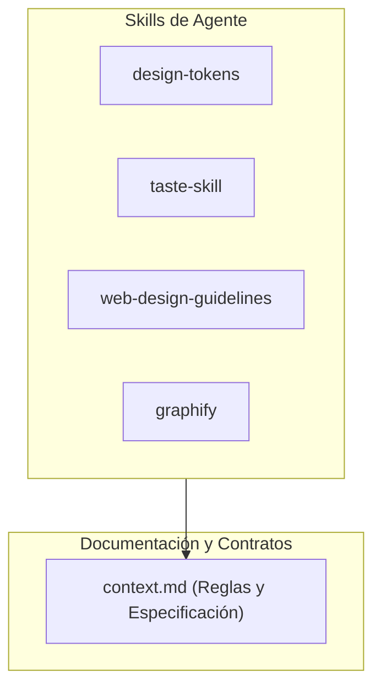

# Repository Architecture Graph & Feature Log (Graphify)

Este documento registra los nodos arquitectónicos y el mapa de dependencias actualizado por cada feature implementada.

---

## Mapa de Nodos y Conexiones

---

## Log de Features Registradas

### [Feature 0] Inicialización y Configuración de Reglas
- **Fecha**: 2026-10-06
- **Archivos creados/modificados**:
  - `context.md` (especificación técnica y de flujo)
  - `.agents/skills/*` (tokens, taste, web guidelines, graphify)
  - `.gitignore` (exclusiones de entorno, build y temporales)
  - `GRAPH.md` (mapa de dependencias)
- **Conexiones**:
  - `context.md` define los tokens consumidos por `design-tokens`.
  - `design-tokens` y `taste-skill` alimentan las reglas de diseño para la futura UI.
- **Estado de validación**: Repositorio Git inicializado y vinculado con origen remoto.
